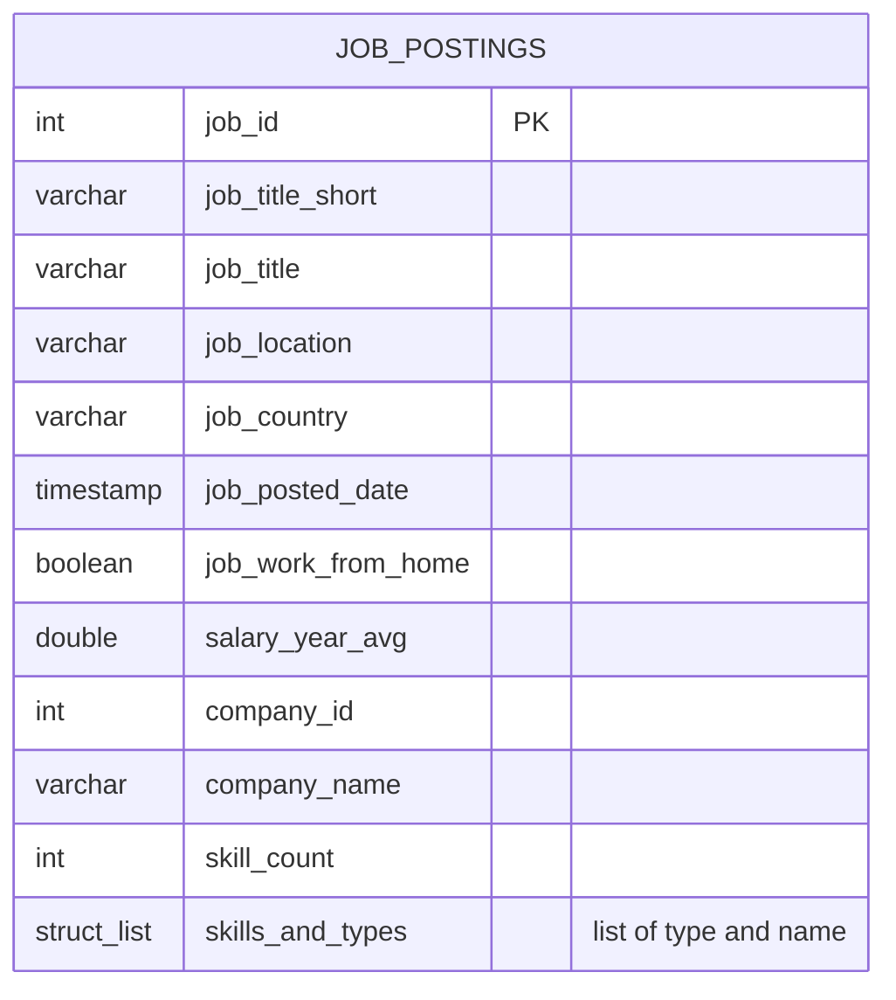
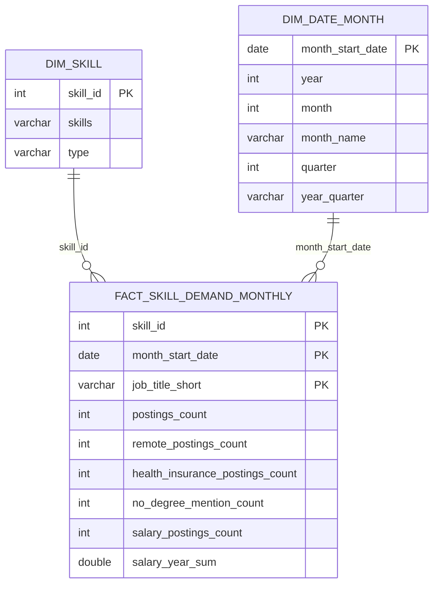
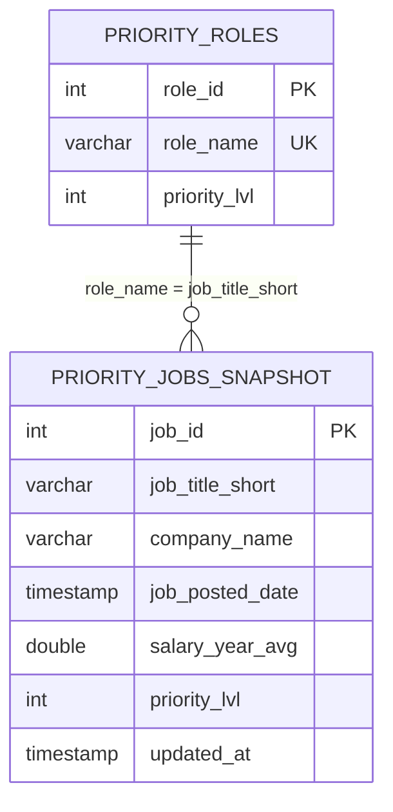
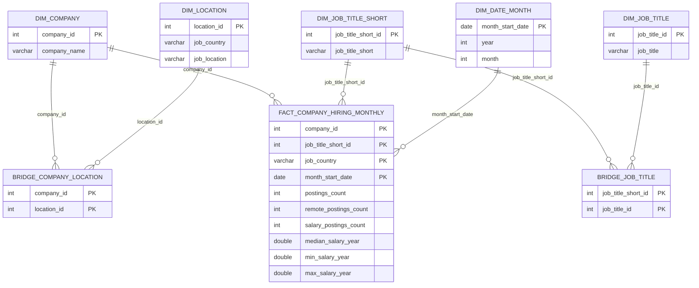

# 🏗️ Data Warehouse & Mart Build: Production ETL Pipeline

An end-to-end data engineering pipeline that loads raw CSV files from Google Cloud Storage into a star schema data warehouse, builds four analytical data marts on top of it, and finishes with automated data quality checks.


---

## 🧾 Executive Summary

- ✅ **Pipeline scope:** Built a complete **ETL pipeline**: raw CSVs → star schema warehouse → 4 analytical marts → data quality checks, run with a single command
- ✅ **Data modeling:** Designed a **star schema** with fact, dimension and bridge tables, plus mart-level dimensional models with clearly defined grains
- ✅ **ETL development:** Every step is **idempotent** (safe to re-run), including the incremental `MERGE` step
- ✅ **Data quality:** 18 automated checks (keys, referential integrity, value ranges, mart-to-warehouse reconciliation). All error-level checks pass
- ✅ **Performance:** Profiled the build and cut the mart steps from **~6.5 min to ~1.5 min** (see [Performance Tuning](#performance-tuning))

---

## 🧩 Problem & Context

Raw job posting data arrives as flat CSV files in Google Cloud Storage, which isn't structured for analysis. Analysts need to answer:

- Which skills are most in-demand over time?
- What are hiring trends by company and location?
- How do salary patterns vary by role and skill?

**Challenge:** Data teams need a single source of truth (a data warehouse) for consistent, reliable analysis across the organization. On top of that, specialized data marts pre-aggregate data for specific business use cases, which reduces query complexity and improves performance for common analytical patterns.

**Solution:** An ETL pipeline that extracts CSVs from cloud storage, loads them into a star schema warehouse (separating facts from dimensions), builds marts optimized for specific use cases, and validates every layer before anyone uses it.

---

## 🧰 Tech Stack

- 🐤 **Database:** DuckDB (file-based OLAP database, reads CSVs straight from GCS over HTTPS)
- 🧮 **Language:** SQL (DDL for schema design, DML for loading and transformation, `MERGE` for incremental updates)
- 📊 **Data Model:** Star schema (fact + dimension + bridge tables)
- 🛠️ **Development:** VS Code for SQL editing + Terminal for DuckDB CLI execution
- 🔧 **Automation:** Master SQL script for pipeline orchestration
- 📦 **Version Control:** Git/GitHub for versioned pipeline scripts
- ☁️ **Storage:** Google Cloud Storage for source CSV files

---

## 📂 Repository Structure

```text
2_DW_Mart_Build/
├── 01_create_tables_dw.sql        # Star schema DDL
├── 02_load_schema_dw.sql          # Extract CSVs from GCS & load the warehouse
├── 03_create_flat_mart.sql        # Denormalized flat mart
├── 04_create_skills_mart.sql      # Monthly skills demand mart
├── 05_create_priority_mart.sql    # Priority roles snapshot mart
├── 06_update_priority_mart.sql    # Incremental update with MERGE (upsert)
├── 07_create_company_mart.sql     # Company hiring mart
├── 08_data_quality_checks.sql     # Data quality & reconciliation checks
├── build_dw_marts.sql             # Master build script (runs 01 → 08)
└── README.md                      # You are here
```

---

## How to Run

Requires the [DuckDB CLI](https://duckdb.org/docs/installation/) (built and tested with v1.4).

```bash
cd 2_DW_Mart_Build
duckdb dw_marts.duckdb -c ".read build_dw_marts.sql"
```

- The database file is created if it doesn't exist (it's git-ignored, ~500 MB once built)
- `.bail on` stops the build at the first error, and `.timer on` prints how long each statement takes
- Every step drops and recreates its own objects, so the whole build (or any single step) can be re-run safely
- To build in MotherDuck instead, run `duckdb "md:dw_marts" -c ".read build_dw_marts.sql"` with `MOTHERDUCK_TOKEN` set

---

## 🏗️ Pipeline Architecture

The pipeline loads job posting CSVs from Google Cloud Storage into the warehouse, then builds specialized marts from it. BI tools (Excel, Power BI, Tableau, Python) can consume from both the warehouse and the marts.

### Data Warehouse


- **SQL Files:**
  - [`01_create_tables_dw.sql`](./01_create_tables_dw.sql) – Defines the star schema with primary and foreign keys
  - [`02_load_schema_dw.sql`](./02_load_schema_dw.sql) – Reads the CSVs from GCS with `read_csv()` and loads them with explicit column mapping
- **Purpose:** Single source of truth for all analysis (also used by [Project 1](../1_EDA/))
- **Grain:** One row per job posting in `job_postings_fact`

| Table | Rows |
|---|---:|
| `job_postings_fact` | 1,615,930 |
| `skills_job_dim` | 7,193,426 |
| `company_dim` | 215,940 |
| `skills_dim` | 262 |

### Flat Mart

Denormalized table with company and skills already joined, for quick ad-hoc queries.



- **SQL File:** [`03_create_flat_mart.sql`](./03_create_flat_mart.sql)
- **Grain:** One row per job posting (1,615,930 rows, reconciled against the fact table)
- **Key Features:** Skills stored as a `STRUCT(type, name)[]` list, so one row holds everything about a posting. Postings with no skills get an empty list (`[]`) rather than a list holding one `{NULL, NULL}` struct

### Skills Mart

Time-series skill demand with additive measures.



- **SQL File:** [`04_create_skills_mart.sql`](./04_create_skills_mart.sql)
- **Grain:** `skill_id + month_start_date + job_title_short` (52,520 rows)
- **Key Features:** All measures are **additive**, so they can be rolled up to quarter, year or skill type without double counting. Ratios like remote % are computed at query time. Instead of storing an average salary (which can't be re-aggregated), the mart stores `salary_year_sum` and `salary_postings_count` so an accurate average can be rebuilt at any level

### Priority Mart

Tracks the roles I'm targeting, with incremental updates using `MERGE`.



- **SQL Files:**
  - [`05_create_priority_mart.sql`](./05_create_priority_mart.sql) – Initial build: 3 roles, 575,523 jobs
  - [`06_update_priority_mart.sql`](./06_update_priority_mart.sql) – **Incremental update with `MERGE`**: Data Engineer moves to priority 1 and Data Scientist is added, so the snapshot grows to 906,525 jobs
- **Grain:** One row per job posting in a priority role
- **Key Features:**
  - One `MERGE` handles `UPDATE` (priority changed), `INSERT` (new jobs) and `DELETE` (`WHEN NOT MATCHED BY SOURCE`)
  - `IS DISTINCT FROM` in the match condition means only rows that actually changed get a new `updated_at`. Senior Data Engineer and Software Engineer rows keep their original timestamp
  - The roles table is also updated with `MERGE` instead of a plain `INSERT`, so step 6 can be run repeatedly without primary key errors (tested by running it twice in a row)

### Company Mart

Company hiring trends by role, location and month.



- **SQL File:** [`07_create_company_mart.sql`](./07_create_company_mart.sql)
- **Grain:** `company_id + job_title_short_id + job_country + month_start_date` (965,738 rows)
- **Key Features:**
  - Bridge tables for many-to-many relationships: companies ↔ locations (556,875 pairs) and standardised role ↔ raw job title (457,950 titles)
  - Surrogate keys generated with `ROW_NUMBER()` (see [Performance Tuning](#performance-tuning))
  - Counts are additive. Median/min/max salary are **not**, which is documented in the DDL so nobody sums or averages them across rows

---

## ✅ Data Quality Checks

[`08_data_quality_checks.sql`](./08_data_quality_checks.sql) runs last and reports each check as `PASS`, `WARN` or `FAIL`:

| Layer | Checks |
|---|---|
| Warehouse | Duplicate `job_id`, orphaned foreign keys in the fact and bridge tables, NULL / future posting dates, salary outside $10K–$1M |
| Flat mart | Row count = fact table, total `skill_count` = bridge table rows |
| Skills mart | `SUM(postings_count)` reconciles to the bridge table, remote count never exceeds total |
| Priority mart | Every snapshot row maps to a role, priority levels are in sync after the `MERGE`, row count matches source |
| Company mart | `SUM(postings_count)` reconciles to eligible fact rows, each raw title maps to exactly one role |

**Latest result: 16 passed, 2 warnings, 0 failed.** The two warnings are source data facts, not pipeline bugs:
- 285,375 postings (~18%) have **no skills** extracted
- 1,125 postings have **no country**, so they're excluded from the company mart fact table

---

## Performance Tuning

My first version of the mart steps took **~6.5 minutes**. I timed each script, then profiled the slow queries with `PRAGMA enable_profiling`:

| Step | Before | After | Change |
|---|---:|---:|---|
| `03_create_flat_mart.sql` | 307 s | ~25 s | Pre-aggregate skills per `job_id`, then join, instead of `GROUP BY` on all 17 wide fact columns. Replaced `ARRAY_AGG(... ORDER BY ...)` with `LIST_SORT(ARRAY_AGG(...))`. The ordered aggregate alone cost ~170 s vs ~9 s |
| `07_create_company_mart.sql` | – | ~56 s | Surrogate keys via `ROW_NUMBER()` over a sorted `DISTINCT` list. The common alternative (self-join counting how many values sort before each one) is O(n²), roughly 10¹¹ comparisons on 457,950 distinct job titles |
| Steps 04–06, 08 | ~18 s | ~18 s | Already fast |

Measured on a 4-core laptop. The CSV load in step 2 depends mostly on network speed.

---

## 🔎 Sample Insights from the Marts

- **Remote work is shrinking:** remote data engineer postings peaked at **17.2% in 2024-Q1** and fell to **~4% in 2025**. The sharp drop in posting volume in 2024-Q4 suggests part of this could be a change in how the source data was collected, so I'd validate it before presenting it as a market trend
- **Top "companies" are job boards:** the company mart shows beBee Careers, Listopro and Dice as the top hirers of data engineers. These are aggregators, not employers, and would need to be flagged or filtered before using the mart for real company prospecting
- **Title sprawl:** 10 standardised roles map to **457,950** distinct raw job titles, which is why the `job_title_short` standardisation (and the title bridge table) is so useful

---

## 💻 Data Engineering Skills Demonstrated

### ETL Pipeline Development
- **Extract:** Direct CSV loading from Google Cloud Storage using DuckDB's `read_csv()` over HTTPS
- **Transform:** Denormalization, date truncation (`DATE_TRUNC`), boolean flag aggregation, nested types (`STRUCT`, lists)
- **Load:** Idempotent builds with `DROP ... IF EXISTS` / `DROP SCHEMA ... CASCADE`
- **Incremental Updates:** `MERGE INTO` upsert with `WHEN MATCHED`, `WHEN NOT MATCHED` and `WHEN NOT MATCHED BY SOURCE`
- **Orchestration:** Master SQL script (`build_dw_marts.sql`) with fail-fast (`.bail on`) and timing

### Dimensional Modeling
- **Star Schema Design:** Fact table (`job_postings_fact`) with dimension tables (`company_dim`, `skills_dim`)
- **Bridge Tables:** Many-to-many relationships (`skills_job_dim`, `bridge_company_location`, `bridge_job_title`)
- **Grain Definition:** Explicit grain for every fact table, enforced with composite primary keys
- **Additive vs Non-Additive Measures:** Stored sums + counts instead of averages where re-aggregation is needed, and documented which measures can't be re-aggregated
- **Surrogate Keys:** Sequential ID generation with `ROW_NUMBER()`

### SQL Techniques
- **DDL:** `CREATE SCHEMA`, `CREATE TABLE` with `PRIMARY KEY`, `FOREIGN KEY` and `UNIQUE` constraints
- **DML:** `INSERT INTO ... SELECT`, `MERGE INTO`, temp tables for staging
- **CTEs & Window Functions:** `WITH` pipelines, `ROW_NUMBER()`, `QUALIFY` for top-N per group
- **Aggregation:** `COUNT(*) FILTER (WHERE ...)`, `MEDIAN()`, `ARRAY_AGG` + `STRUCT_PACK`, `LIST_SORT`
- **NULL Handling:** `IS DISTINCT FROM`, `COALESCE`, `NULLIF` to avoid divide-by-zero

### Data Quality & Production Practices
- **Idempotency:** All scripts safely re-runnable, verified by running the update step twice
- **Data Validation:** Automated quality checks plus verification queries at the end of every step
- **Reconciliation:** Mart totals tied back to warehouse counts
- **Performance Profiling:** Timed and profiled each step and optimized the bottlenecks
- **Schema Organization:** Separate schemas (`flat_mart`, `skills_mart`, `priority_mart`, `company_mart`) for logical separation
