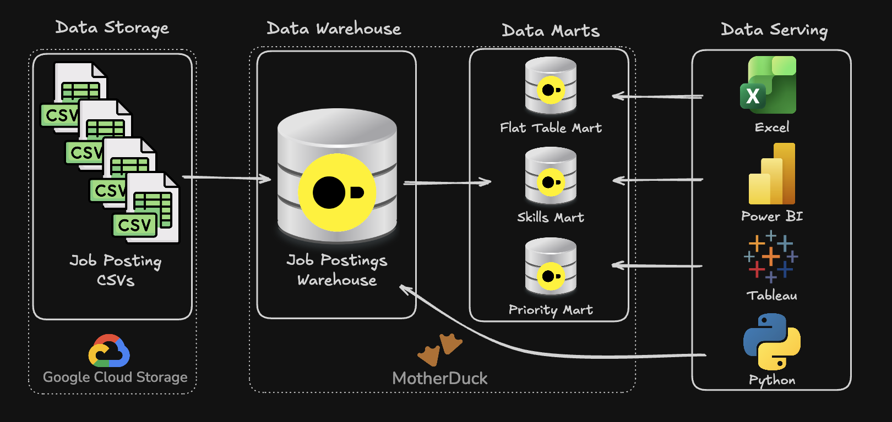

# SQL Data Engineering Projects
A collection of SQL projects I built to practice and reinforce my data analysis and data engineering skills, using DuckDB and ~1.6M real data job postings (2023 - 2025).

> Click a project name below to see how I built it, the tools I used and what I found!

## Projects
### [1. EDA](/1_EDA/) - Exploratory Data Analysis


SQL-driven analysis of the data engineer job market: which skills are most in demand, which pay the most, which give the best balance of both, and which are rising or falling over time.

**Skills:** Complex joins, aggregations, CTEs, window functions, log-scaled scoring, salary sample-size validation

### [2. Data Warehouse & Mart Build](/2_DW_Mart_Build/) - ETL Pipeline


End-to-end ETL pipeline that loads raw CSVs from Google Cloud Storage into a star schema data warehouse, builds 4 analytical data marts (flat, skills, priority, company), applies incremental updates with `MERGE`, and validates every layer with automated data quality checks.

**Skills:** Dimensional modeling, ETL pipeline development, incremental loads (`MERGE`), data quality checks, query performance tuning

## Tech Stack
- 🐤 **DuckDB** - analytical database & query engine
- 🧮 **SQL** - DDL, DML, CTEs, window functions, `MERGE`
- ☁️ **Google Cloud Storage** - source CSV files
- 🛠️ **VS Code + DuckDB CLI** - development & execution
- 📦 **Git / GitHub** - version control

## Quick Start
```bash
# 1. Build the warehouse and marts (Project 2)
cd 2_DW_Mart_Build
duckdb dw_marts.duckdb -c ".read build_dw_marts.sql"

# 2. Run the analysis queries (Project 1)
cd ../1_EDA
duckdb ../2_DW_Mart_Build/dw_marts.duckdb -c ".read 03_optimal_skills.sql"
```

## Repository Structure
```text
├── 1_EDA/              # Project 1 - analysis queries
├── 2_DW_Mart_Build/    # Project 2 - warehouse + mart pipeline
├── Images/             # Diagrams used in the READMEs
└── Lessons/            # SQL practice files from my learning (DDL/DML, joins, CTEs, window functions, ...)
```
